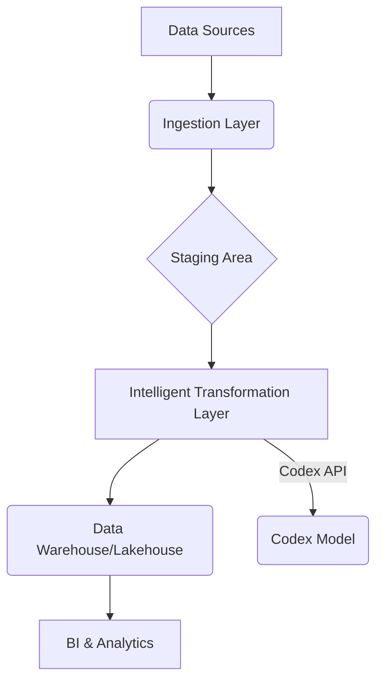

+++
title = "Deep Dive into Codex: Architecting Intelligent Data Pipelines with AI"
date = "2026-10-14"
tags = ["codex","data-engineering","ai","automation","pipelines","orchestration","llm"]
categories = ["technical-deep-dives"]
banner = "img/banners/2026-10-14-deep-dive-into-codex-architecting-intelligent-data-pipelines-with-ai.jpg"
+++

In the ever-evolving landscape of data engineering, the drive towards intelligent automation is relentless. While ETL/ELT tools have revolutionized data movement, the true frontier lies in empowering these pipelines with cognitive capabilities. This is where technologies like OpenAI's Codex, when thoughtfully integrated, can transform static data flows into dynamic, self-optimizing systems.

This deep dive isn't about a high-level "what is Codex?" overview. We're going under the hood, exploring how to architect and implement Codex-powered solutions for practical data pipeline challenges. We'll focus on the architectural patterns, configuration nuances, and real-world implementation hurdles.

## Beyond Code Generation: Codex as a Data Pipeline Orchestrator

While Codex is famously known for generating code from natural language, its true power in data engineering emerges when we leverage its understanding of context and intent to drive pipeline logic. Think of it not just as a code writer, but as a sophisticated interpreter that can translate business requirements into actionable data transformations.

### Architectural Pattern: The "Intelligent Transformation Layer"

At DataFibers, we often advocate for an "Intelligent Transformation Layer" (ITL) within our data architectures. This layer sits between raw data ingestion and curated data consumption, responsible for cleaning, transforming, and enriching data. Integrating Codex into this layer can unlock unprecedented flexibility.

**Diagram: Intelligent Transformation Layer Architecture**



In this pattern:

*   **Ingestion Layer:** Standard data connectors and ingestion pipelines.
*   **Staging Area:** Raw, un Fmodified data.
*   **Intelligent Transformation Layer:** The core of our discussion. This layer will host components that dynamically generate and execute transformation logic using Codex.
*   **Data Warehouse/Lakehouse:** The structured, curated data store.
*   **BI & Analytics:** Downstream consumers of the transformed data.

### Core Components of an ITL with Codex

1.  **Contextualizer Module:** This module is crucial for feeding Codex the right information. It needs to understand the schema of incoming data, the desired output schema, business rules, and any historical transformation logic.
2.  **Prompt Engineering Engine:** This component crafts the specific prompts sent to the Codex API. The quality of prompts directly impacts the quality of the generated code.
3.  **Code Execution Engine:** Once Codex returns Python code (or SQL, etc.), this engine safely executes it within the pipeline's runtime environment.
4.  **Feedback Loop & Retraining Module:** For continuous improvement, the system needs to monitor the success of transformations, capture errors, and potentially use this data to refine future prompts or even fine-tune a Codex model.

## Practical Implementation: A Case Study - Dynamic Schema Mapping

Let's consider a common challenge: dealing with frequently changing source schemas where manual mapping becomes a bottleneck.

**Scenario:** We receive customer data from multiple third-party APIs. Their schemas vary, and new fields are added regularly. We need to map these fields to our internal `customers` table schema.

**Traditional Approach:** Manual SQL `ALTER TABLE` statements and `INSERT/UPDATE` statements, often managed in complex Git repositories with versioning headaches.

**Codex-Powered Approach:** We'll build a Python script that, given a new source schema and our target schema, generates the `INSERT` or `UPDATE` SQL statement.

### Step 1: Contextualization

We need to represent our schemas in a structured format. JSON is a natural fit.

**Target Schema (`target_schema.json`):**

```json
{
  "tableName": "customers",
  "columns": [
    {"name": "customer_id", "dataType": "INT", "isNullable": false},
    {"name": "first_name", "dataType": "VARCHAR(255)", "isNullable": true},
    {"name": "last_name", "dataType": "VARCHAR(255)", "isNullable": true},
    {"name": "email", "dataType": "VARCHAR(255)", "isNullable": false},
    {"name": "signup_date", "dataType": "DATE", "isNullable": true},
    {"name": "country_code", "dataType": "VARCHAR(2)", "isNullable": true}
  ]
}
```

**Source Schema (e.g., from API `source_schema_api_v1.json`):**

```json
{
  "tableName": "external_customers_v1",
  "columns": [
    {"name": "id", "dataType": "INTEGER"},
    {"name": "fname", "dataType": "STRING"},
    {"name": "lname", "dataType": "STRING"},
    {"name": "email_address", "dataType": "VARCHAR(100)"},
    {"name": "creation_ts", "dataType": "TIMESTAMP"},
    {"name": "user_country"}
  ]
}
```

### Step 2: Prompt Engineering

The prompt needs to be precise. We'll instruct Codex to generate an SQL `INSERT` statement, mapping source columns to target columns based on semantic similarity and providing explicit mapping rules where needed.

**Prompt Template (using f-strings in Python):**

```python
target_schema_str = json.dumps(target_schema, indent=2)
source_schema_str = json.dumps(source_schema, indent=2)

prompt = f"""
Generate an SQL INSERT statement to insert data from a source table into a target table.

Target Table Schema:
{target_schema_str}

Source Table Schema:
{source_schema_str}

Rules:
1. Map 'id' from source to 'customer_id' in target. Ensure it's an INT.
2. Map 'fname' from source to 'first_name' in target.
3. Map 'lname' from source to 'last_name' in target.
4. Map 'email_address' from source to 'email' in target.
5. Map 'creation_ts' (TIMESTAMP) from source to 'signup_date' (DATE) in target.
6. Map 'user_country' from source to 'country_code' in target.
7. If a source column is not present in the target schema, ignore it.
8. If a target column is not mapped from the source, use NULL if nullable, otherwise raise an error (for simplicity, we'll aim to map all non-nullable fields).
9. Assume the source data will be provided as a dictionary or row-like object where keys match source column names.
10. Output only the SQL INSERT statement. Do not include surrounding text or explanations.

Example of expected output format:
INSERT INTO customers (customer_id, first_name, last_name, email, signup_date, country_code) VALUES ({source_column_for_id}, {source_column_for_fname}, {source_column_for_lname}, {source_column_for_email}, DATE({source_column_for_creation_ts}), {source_column_for_country_code});
"""
```

**Note:** The `Example of expected output format` is crucial. It guides Codex to generate syntactically correct SQL, including how to handle data type conversions (like `DATE()`). The `{source_column_for_...}` placeholders are placeholders for the actual source column names that the prompt engine would dynamically insert.

### Step 3: Interacting with the OpenAI API

We'll use the `openai` Python library. For production, you'd manage API keys securely (e.g., environment variables, secrets management).

```python
import openai
import os
import json

# Ensure your OPENAI_API_KEY is set in your environment variables
# openai.api_key = os.getenv("OPENAI_API_KEY")

def generate_sql_mapping(target_schema, source_schema):
    """Generates an SQL INSERT statement using Codex."""
    target_schema_str = json.dumps(target_schema, indent=2)
    source_schema_str = json.dumps(source_schema, indent=2)

    # Dynamically construct the example placeholder values
    source_column_placeholders = {}
    for col in source_schema['columns']:
        source_column_placeholders[col['name']] = col['name'] # Simple mapping for example

    # Construct the example output, dynamically substituting source column names
    # This is a simplified representation; a real implementation would need more robust mapping logic
    example_output_parts = []
    target_col_names = {c['name'] for c in target_schema['columns']}
    source_col_names = {c['name'] for c in source_schema['columns']}

    for target_col in target_schema['columns']:
        mapped_source_col = None
        if target_col['name'] == 'customer_id' and 'id' in source_column_placeholders:
            mapped_source_col = source_column_placeholders['id']
        elif target_col['name'] == 'first_name' and 'fname' in source_column_placeholders:
            mapped_source_col = source_column_placeholders['fname']
        elif target_col['name'] == 'last_name' and 'lname' in source_column_placeholders:
            mapped_source_col = source_column_placeholders['lname']
        elif target_col['name'] == 'email' and 'email_address' in source_column_placeholders:
            mapped_source_col = source_column_placeholders['email_address']
        elif target_col['name'] == 'signup_date' and 'creation_ts' in source_column_placeholders:
            mapped_source_col = f"DATE({source_column_placeholders['creation_ts']})"
        elif target_col['name'] == 'country_code' and 'user_country' in source_column_placeholders:
            mapped_source_col = source_column_placeholders['user_country']
        
        if mapped_source_col:
            example_output_parts.append(mapped_source_col)
        elif target_col['isNullable']:
            example_output_parts.append("NULL")
        else:
            # In a real scenario, you'd handle this error or default value more gracefully
            example_output_parts.append(f"'MISSING_MANDATORY_FIELD_{target_col['name']}'")

    example_output_str = f"INSERT INTO {target_schema['tableName']} ({', '.join([c['name'] for c in target_schema['columns']])}) VALUES ({', '.join(example_output_parts)});
"


    prompt = f"""
Generate an SQL INSERT statement to insert data from a source table into a target table.

Target Table Schema:
{target_schema_str}

Source Table Schema:
{source_schema_str}

Rules:
1. Map 'id' from source to 'customer_id' in target. Ensure it's an INT.
2. Map 'fname' from source to 'first_name' in target.
3. Map 'lname' from source to 'last_name' in target.
4. Map 'email_address' from source to 'email' in target.
5. Map 'creation_ts' (TIMESTAMP) from source to 'signup_date' (DATE) in target.
6. Map 'user_country' from source to 'country_code' in target.
7. If a source column is not present in the target schema, ignore it.
8. If a target column is not mapped from the source, use NULL if nullable, otherwise indicate missing mandatory field.
9. Assume the source data will be provided as a dictionary or row-like object where keys match source column names.
10. Output ONLY the SQL INSERT statement. Do not include surrounding text or explanations.

Example of expected output format:
{example_output_str}
"""

    try:
        response = openai.ChatCompletion.create(
            model="gpt-3.5-turbo", # Or "gpt-4" for potentially better results
            messages=[
                {"role": "system", "content": "You are a helpful assistant that generates SQL code."}, # System message can set the persona
                {"role": "user", "content": prompt}
            ],
            temperature=0.1, # Lower temperature for more deterministic output
            max_tokens=500
        )
        sql_statement = response.choices[0].message['content'].strip()
        return sql_statement
    except Exception as e:
        print(f"Error generating SQL: {e}")
        return None

# --- Example Usage ---
target_schema = {
  "tableName": "customers",
  "columns": [
    {"name": "customer_id", "dataType": "INT", "isNullable": false},
    {"name": "first_name", "dataType": "VARCHAR(255)", "isNullable": true},
    {"name": "last_name", "dataType": "VARCHAR(255)", "isNullable": true},
    {"name": "email", "dataType": "VARCHAR(255)", "isNullable": false},
    {"name": "signup_date", "dataType": "DATE", "isNullable": true},
    {"name": "country_code", "dataType": "VARCHAR(2)", "isNullable": true}
  ]
}

source_schema = {
  "tableName": "external_customers_v1",
  "columns": [
    {"name": "id", "dataType": "INTEGER"},
    {"name": "fname", "dataType": "STRING"},
    {"name": "lname", "dataType": "STRING"},
    {"name": "email_address", "dataType": "VARCHAR(100)"},
    {"name": "creation_ts", "dataType": "TIMESTAMP"},
    {"name": "user_country"}
  ]
}

generated_sql = generate_sql_mapping(target_schema, source_schema)
print(f"Generated SQL:\n{generated_sql}")
```

### Step 4: Code Execution and Orchestration

Once we have the generated SQL, we need to execute it. This would typically happen within an orchestration framework like Apache Airflow, Prefect, or Dagster.

```python
# Assuming generated_sql contains the SQL string from the previous step
# and you have a database connection object `db_connection`

# Example using a hypothetical db_connection object
# try:
#     with db_connection.cursor() as cursor:
#         cursor.execute(generated_sql)
#         db_connection.commit()
#         print("Data inserted successfully!")
# except Exception as e:
#     print(f"Error executing SQL: {e}")
#     db_connection.rollback()
```

## Implementation Challenges and Best Practices

1.  **Prompt Engineering is Key:** The quality of the generated SQL/code is directly proportional to the quality and specificity of your prompts. Iteration and testing are vital.
2.  **Handling Ambiguity:** Natural language can be ambiguous. Codex might misunderstand mappings. Robust error handling and validation are necessary. We saw this with the `MISSING_MANDATORY_FIELD` placeholder.
3.  **Data Type Conversions:** Explicitly guiding Codex on how to handle data type conversions (e.g., `TIMESTAMP` to `DATE`, `STRING` to `INT`) in the prompt is critical.
4.  **Security:** Never embed sensitive information directly in prompts. Use placeholders and ensure the execution environment is secure.
5.  **Cost and Latency:** Frequent API calls to Codex can incur costs. For high-volume, low-latency transformations, pre-generated or optimized SQL might still be necessary. Codex is best for dynamic, less frequent, or configuration-driven transformations.
6.  **Determinism vs. Creativity:** Setting `temperature` to a low value (e.g., 0.1) makes Codex more deterministic and predictable, which is usually desired for data transformations. Higher temperatures can lead to more creative (and potentially incorrect) outputs.
7.  **Model Choice:** `gpt-3.5-turbo` is generally faster and cheaper, while `gpt-4` might offer better accuracy and understanding for complex prompts.
8.  **Idempotency:** Ensure generated transformations are idempotent, meaning running them multiple times has the same effect as running them once. This is crucial for reliable data pipelines.
9.  **Monitoring and Alerting:** Implement comprehensive logging and monitoring for the Codex API calls and the execution of generated code. Set up alerts for failed transformations.

## Advanced Use Cases

*   **Dynamic Data Cleaning Rules:** Generate Python UDFs (User Defined Functions) for complex cleaning logic based on descriptions.
*   **Automated Data Validation Rule Generation:** Translate business rules into SQL `CHECK` constraints or custom validation scripts.
*   **Feature Engineering Assistance:** Describe a desired feature, and have Codex suggest or generate Python code for its calculation.

## Conclusion

Codex represents a paradigm shift in how we can build intelligent data pipelines. By moving beyond simple code generation and embracing its contextual understanding, we can create highly adaptable and automated data transformation layers. While challenges remain in prompt engineering, error handling, and cost management, the potential for reducing development time and increasing pipeline flexibility is immense. As you explore integrating AI into your data fabric, consider Codex not just as a tool, but as a collaborator in architecting the future of data engineering.