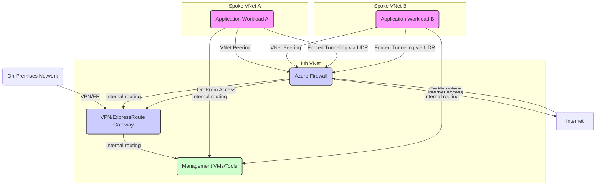

+++
title = "Beyond the Basics: Demystifying Azure Networking for Secure Interconnections"
date = "2026-10-28"
tags = ["azure-cloud"]
categories = ["Cloud Architecture"]
banner = "img/banners/2026-10-28-beyond-the-basics-demystifying-azure-networking-for-secure-interconnections.jpg"
+++

In the sprawling landscape of cloud computing, networking isn't just a configuration step; it's the fundamental backbone defining the security, performance, and scalability of your entire infrastructure. While Azure provides intuitive interfaces for spinning up Virtual Networks (VNets), truly mastering Azure networking demands a deep dive into its underlying mechanisms, architectural patterns, and the practical challenges of building robust, interconnected systems.

This post goes beyond generic overviews. We'll peel back the layers to understand how Azure's networking constructs truly operate, explore critical inter-VNet communication, and delve into private connectivity options, all illuminated with code, CLI commands, and architectural diagrams.

### 1. The Foundation: Virtual Networks (VNets) and Subnets – More Than Just IP Spaces

At its core, an Azure VNet is your private network in the cloud, isolated from other Azure tenants. It's defined by an IP address space (CIDR block) from which subnets are carved. But there's more to it:

*   **IP Allocation:** Azure reserves the first four and last IP addresses within each subnet for internal use (e.g., default gateway, DNS). Always account for this when sizing your subnets.
*   **Service Delegation:** Subnets can be *delegated* to specific Azure services (like Azure Container Instances, Azure SQL Managed Instance, or Azure NetApp Files). This allows the service to inject its network interfaces directly into your subnet, providing private connectivity and allowing NSGs to protect it.
*   **DNS:** By default, VNets use Azure-provided DNS. You can specify custom DNS servers, crucial for hybrid environments or specific naming conventions.

Let's provision a basic VNet with two subnets using the Azure CLI:

```bash
az group create --name DataFibersRG --location eastus
az network vnet create \
    --resource-group DataFibersRG \
    --name df-vnet-hub \
    --address-prefix 10.0.0.0/16 \
    --subnet-name GatewaySubnet --subnet-prefix 10.0.0.0/27 \
    --subnet-name AppSubnet --subnet-prefix 10.0.1.0/24

az network vnet subnet create \
    --resource-group DataFibersRG \
    --vnet-name df-vnet-hub \
    --name DbSubnet \
    --address-prefix 10.0.2.0/24
```

Notice `GatewaySubnet` has a `/27` prefix. While technically smaller prefixes might work, Azure mandates a minimum `/27` for specific gateway types (VPN Gateway, ExpressRoute Gateway) to ensure sufficient internal IPs.

### 2. The Gatekeepers: Network Security Groups (NSGs) and Application Security Groups (ASGs)

NSGs are stateful, layer 4 (TCP/UDP) packet filters that apply to network interfaces (NICs) or subnets. They control inbound and outbound traffic based on source/destination IP, port, and protocol. Understanding their processing order is critical:

1.  **Rule Priority:** Rules are processed by priority number (100-4096). Lower numbers are processed first.
2.  **Inbound/Outbound:** Separate rule sets for each direction.
3.  **Default Rules:** Azure provides default rules (e.g., allow VNet traffic, allow load balancer, deny all inbound/outbound). User-defined rules can override these.

**Under the Hood:** While an NSG *appears* to filter, Azure's SDN (Software Defined Network) orchestrates the actual filtering at the hypervisor level, making them highly efficient. The "stateful" aspect means that once an outbound connection is permitted (e.g., a VM initiates a connection to a web server), the return traffic for that specific connection is automatically allowed, even if no explicit inbound rule exists for it.

**Application Security Groups (ASGs)** simplify NSG management by allowing you to group VMs or NICs based on application workload rather than explicit IP addresses. Instead of creating rules for individual VM IPs, you refer to the ASG.

Here's a Bicep example demonstrating NSG rules with an ASG:

```bicep
resource nsg 'Microsoft.Network/networkSecurityGroups@2021-02-01' = {
  name: 'df-nsg-app'
  location: resourceGroup().location
  properties: {
    securityRules: [
      {
        name: 'AllowSSHFromJumphost'
        properties: {
          priority: 100
          direction: 'Inbound'
          access: 'Allow'
          protocol: 'Tcp'
          sourcePortRange: '*'
          destinationPortRange: '22'
          sourceAddressPrefix: '10.0.10.10' // Jumphost IP
          destinationAddressPrefix: '*'
        }
      }
      {
        name: 'AllowWebTrafficToAppASG'
        properties: {
          priority: 200
          direction: 'Inbound'
          access: 'Allow'
          protocol: 'Tcp'
          sourcePortRange: '*'
          destinationPortRange: '80'
          sourceAddressPrefix: 'Internet'
          destinationApplicationSecurityGroups: [
            {
              id: appAsg.id
            }
          ]
        }
      }
      {
        name: 'DenyAllOutbound'
        properties: {
          priority: 4000 // High priority to ensure it's processed after specific allows
          direction: 'Outbound'
          access: 'Deny'
          protocol: '*'
          sourcePortRange: '*'
          destinationPortRange: '*'
          sourceAddressPrefix: '*'
          destinationAddressPrefix: 'Internet' // Deny all outbound to internet by default
        }
      }
    ]
  }
}

resource appAsg 'Microsoft.Network/applicationSecurityGroups@2021-02-01' = {
  name: 'df-app-servers-asg'
  location: resourceGroup().location
  properties: {}
}

// To associate a NIC with this ASG, you'd add this to the NIC definition:
// properties: {
//   ipConfigurations: [
//     {
//       name: 'ipconfig1'
//       properties: {
//         privateIPAllocationMethod: 'Dynamic'
//         subnet: { id: appSubnet.id }
//         applicationSecurityGroups: [
//           { id: appAsg.id }
//         ]
//       }
//     }
//   ]
// }
```

### 3. Directing the Flow: User Defined Routes (UDRs)

Azure's default routing allows resources within a VNet to communicate and provides outbound internet access. However, often you need to override this behavior, typically to force traffic through a Network Virtual Appliance (NVA) like a firewall or a VPN Gateway. This is where UDRs come in.

UDRs are applied to subnets. When a packet leaves a VM, Azure checks if a UDR exists for its destination. If so, it follows the UDR; otherwise, it uses Azure's default routing. Key `nextHopType` values include:

*   `VirtualAppliance`: Traffic is sent to a specific private IP address (e.g., an Azure Firewall).
*   `VirtualNetworkGateway`: Traffic is sent to a VPN or ExpressRoute Gateway.
*   `Internet`: Traffic is sent directly to the internet.
*   `None`: Traffic is dropped.

**Common Use Case:** Forcing all outbound internet traffic from spoke VNets through a centralized Azure Firewall in a hub VNet.

```bicep
resource routeTable 'Microsoft.Network/routeTables@2021-02-01' = {
  name: 'df-rt-spoke-firewall'
  location: resourceGroup().location
  properties: {
    disableBgpRoutePropagation: false // Set to true if you don't want VPN/ExpressRoute routes propagating
    routes: [
      {
        name: 'ToFirewall'
        properties: {
          addressPrefix: '0.0.0.0/0' // All traffic
          nextHopType: 'VirtualAppliance'
          nextHopIpAddress: '10.0.0.4' // Private IP of the Azure Firewall in the hub VNet
        }
      }
    ]
  }
}

// To associate this route table with a subnet (e.g., AppSubnet in a spoke VNet):
// resource appSubnet 'Microsoft.Network/virtualNetworks/subnets@2021-02-01' existing = {
//   name: 'AppSubnet'
//   parent: dfSpokeVnet
// }
// resource appSubnetRouteTableAssociation 'Microsoft.Network/virtualNetworks/subnets@2021-02-01' = {
//   name: appSubnet.name
//   parent: dfSpokeVnet
//   properties: {
//     addressPrefix: '10.1.1.0/24' // Must match the existing subnet's address prefix
//     routeTable: { id: routeTable.id }
//   }
// }
```

### 4. Interconnecting Networks: VNet Peering – The Non-Transitive Link

VNet peering enables seamless, low-latency, high-bandwidth connectivity between VNets. It's like extending a single network cable between two separate houses, allowing resources in both to communicate as if they were in the same network, without traversing the public internet.

**Key Characteristics:**

*   **Non-Transitive:** This is crucial. If VNet A peers with VNet B, and VNet B peers with VNet C, VNet A *cannot* directly communicate with VNet C through VNet B. You'd need a separate peering between A and C, or a Network Virtual Appliance in VNet B to route traffic.
*   **Global Peering:** Allows peering between VNets in different Azure regions, maintaining high performance and security over the Azure backbone.
*   **DNS Resolution:** Peered VNets do not automatically share DNS zones. You'll often need Private DNS Zones or custom DNS servers to ensure proper name resolution across peered networks.

Let's peer `df-vnet-hub` with a new `df-vnet-spoke`:

```bash
# Create a spoke VNet
az network vnet create \
    --resource-group DataFibersRG \
    --name df-vnet-spoke \
    --address-prefix 10.1.0.0/16 \
    --subnet-name AppSubnet \
    --subnet-prefix 10.1.1.0/24

# Initiate peering from hub to spoke
az network vnet peering create \
    --name df-vnet-hub-to-spoke \
    --resource-group DataFibersRG \
    --vnet-name df-vnet-hub \
    --remote-vnet df-vnet-spoke \
    --allow-vnet-access \
    --allow-forwarded-traffic \
    --allow-gateway-transit # Optional, if hub has a gateway you want to use

# Initiate peering from spoke to hub (required for bi-directional connectivity)
az network vnet peering create \
    --name df-vnet-spoke-to-hub \
    --resource-group DataFibersRG \
    --vnet-name df-vnet-spoke \
    --remote-vnet df-vnet-hub \
    --allow-vnet-access \
    --allow-forwarded-traffic \
    --use-remote-gateways # Optional, to use the hub's gateway
```

### 5. Secure Private Access: Private Link vs. Service Endpoints – Choosing the Right Tool

Securing access to Azure PaaS services (like Storage Accounts, Key Vault, Cosmos DB) is paramount. Azure offers two primary mechanisms, each with distinct advantages:

**a) Service Endpoints:**

*   **Concept:** Service Endpoints extend your VNet's identity to Azure service endpoints over the Azure backbone. Traffic still uses the service's public IP address, but it never leaves the Azure network. It's authenticated and authorized by your VNet's ID.
*   **Security:** Prevents public internet access to the service *from your VNet*, but the service's public endpoint is still reachable from elsewhere on the internet unless firewall rules are applied.
*   **Simplicity:** Easier to configure. Just enable the service endpoint on your subnet and configure the PaaS service to allow traffic from that subnet.

**b) Private Link:**

*   **Concept:** Private Link brings Azure PaaS services *into* your private VNet by creating a Private Endpoint (a network interface) in your VNet with a private IP address. All traffic to the service then flows securely over the Microsoft backbone using this private IP.
*   **Security:** Provides true private access. The PaaS service's public endpoint can be completely disabled, making it unreachable from the public internet entirely.
*   **Complexity:** Requires careful DNS configuration (usually with Azure Private DNS Zones) to ensure that the FQDN of the service resolves to the private IP of the Private Endpoint.

**Analogy:** Imagine accessing a corporate website. With **Service Endpoints**, you're using the public internet address, but the office building recognizes your company ID badge and allows you entry via a dedicated, secure express lane. With **Private Link**, the entire corporate website is mirrored *inside your office building*, and you access it via an internal IP address, bypassing any public entry points altogether.

Here's a simplified CLI workflow for setting up Private Link for an Azure Storage Account:

```bash
# 1. Create a Private DNS Zone for storage accounts
az network private-dns zone create \
    --resource-group DataFibersRG \
    --name "privatelink.blob.core.windows.net"

# 2. Link the Private DNS Zone to your VNet
az network private-dns link vnet create \
    --resource-group DataFibersRG \
    --zone-name "privatelink.blob.core.windows.net" \
    --name df-vnet-hub-dns-link \
    --virtual-network df-vnet-hub \
    --registration-enabled false

# 3. Create a Storage Account (if you don't have one)
az storage account create \
    --resource-group DataFibersRG \
    --name dfdatastorage123 \
    --location eastus \
    --sku Standard_LRS \
    --kind StorageV2

# 4. Create a Private Endpoint in your VNet for the Storage Account
az network private-endpoint create \
    --resource-group DataFibersRG \
    --name df-storage-pe \
    --vnet-name df-vnet-hub \
    --subnet AppSubnet \
    --private-connection-resource-id $(az storage account show -g DataFibersRG -n dfdatastorage123 --query id -o tsv) \
    --group-id blob \
    --connection-name dfStorageConnection \
    --location eastus

# 5. Get the Private IP and add an A record to the Private DNS Zone
# (This step is often automated by Azure when creating the PE, but it's good to understand)
PE_NIC_ID=$(az network private-endpoint show -g DataFibersRG -n df-storage-pe --query 'networkInterfaces[0].id' -o tsv)
PE_IP=$(az network nic show --ids $PE_NIC_ID --query 'ipConfigurations[0].privateIpAddress' -o tsv)
az network private-dns record-set a add-record \
    --resource-group DataFibersRG \
    --zone-name "privatelink.blob.core.windows.net" \
    --record-set-name dfdatastorage123 \
    --ipv4-address $PE_IP
```

This setup ensures that any resource within `df-vnet-hub` trying to access `dfdatastorage123.blob.core.windows.net` will resolve to the private IP `10.0.1.x` and communicate entirely within Azure's private backbone.

### 6. Architectural Patterns: The Hub-Spoke Model with Azure Firewall

One of the most common and robust architectural patterns in Azure is the Hub-Spoke model. It promotes centralized security, shared services, and simplified network management.

*   **Hub VNet:** Contains shared services like Azure Firewall, VPN Gateway/ExpressRoute Gateway, and management tools. All outbound internet traffic and inter-spoke traffic is forced through the Hub's firewall for inspection and policy enforcement.
*   **Spoke VNets:** Host your application workloads. They peer with the Hub VNet.



**Implementation Nuances:**

1.  **VNet Peering:** Establish peering between the Hub and each Spoke. Remember the non-transitive property; Spokes cannot directly communicate with each other via peering.
2.  **UDRs:** Apply a UDR to *each subnet in each Spoke VNet* that forces `0.0.0.0/0` (all traffic) to the private IP address of the Azure Firewall in the Hub VNet. This ensures all outbound and inter-spoke traffic goes through the firewall for inspection.
3.  **Firewall Rules:** Configure Azure Firewall Network Rules and Application Rules to permit legitimate traffic and deny illicit traffic. Azure Firewall is stateful at a global level and provides much more advanced capabilities (Threat Intelligence, FQDN filtering) than NSGs.
4.  **Gateway Transit:** If your Hub VNet has a VPN or ExpressRoute Gateway, ensure peering is configured to `AllowGatewayTransit` from the Hub and `UseRemoteGateways` from the Spokes. This allows Spokes to access on-premises resources via the Hub's gateway.

### Conclusion

Mastering Azure networking is about more than just clicking buttons; it's about understanding the intricate dance of IP addressing, security rules, routing tables, and private connectivity mechanisms. By delving into the 'how' and 'why' behind VNet peering, UDRs, NSGs, and the critical distinction between Service Endpoints and Private Link, you gain the power to design secure, performant, and scalable cloud architectures. The Hub-Spoke model, fortified with Azure Firewall, stands as a testament to these principles, providing a robust foundation for even the most demanding enterprise deployments.

Keep experimenting with Infrastructure as Code (Bicep/Terraform) to automate these configurations and ensure consistency. The Azure network, when properly understood and configured, is your strongest ally in building resilient cloud solutions.