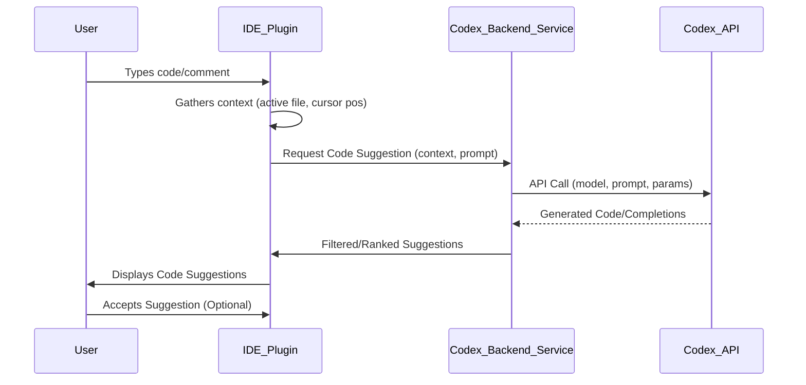

+++
title = "Demystifying Codex: Under-the-Hood with Code Generation Architectures"
date = "2026-11-15"
tags = ["codex"]
categories = ["category1"]
banner = "img/banners/2026-11-15-demystifying-codex-under-the-hood-with-code-generation-architectures.jpg"
+++

## Demystifying Codex: Under-the-Hood with Code Generation Architectures

In the rapidly evolving landscape of software development, tools powered by advanced AI models are transforming how we write, debug, and understand code. At the forefront of this revolution is Codex, the underlying model series that powers tools like GitHub Copilot. While its ability to generate contextually relevant code snippets is widely known, a deep understanding of its architecture, operational patterns, and practical implementation challenges is essential for engineers looking to leverage its full potential.

This deep-dive will move beyond generic overviews, exploring the technical intricacies of Codex-like models, architectural considerations for integrating them, and hands-on strategies for overcoming common hurdles.

### The Foundational Architecture: Transformers and Beyond

At its core, Codex is a large-scale language model (LLM) primarily based on the **Transformer architecture**. While not unique to Codex, understanding how this architecture processes and generates code is fundamental.

1.  **Encoder-Decoder (or Decoder-Only):** Codex, much like its GPT-3 lineage, primarily utilizes a **decoder-only Transformer stack**. This means it's optimized for sequential token generation given an input prompt.
2.  **Attention Mechanism:** The self-attention mechanism is critical. In the context of code, it allows the model to weigh the importance of different parts of the input (e.g., function signatures, variable declarations, import statements) when predicting the next token. For instance, when completing a function call, the model pays attention to the function's definition elsewhere in the context window.
3.  **Tokenization for Code:** Unlike natural language, code has strict syntax and structure. Codex-like models employ specialized tokenization strategies, often based on Byte-Pair Encoding (BPE), but optimized for programming languages. This involves:
    *   Breaking down code into subword units, while often keeping keywords, operators, and common identifiers as single tokens.
    *   Handling whitespace and indentation meaningfully, as these are syntactically relevant in many languages (e.g., Python).
    *   Maintaining information about syntax trees implicitly through token sequences.

    Consider how `my_function_name` might be tokenized as `my`, `_`, `function`, `_`, `name` or as a single unit depending on frequency and context.

4.  **Massive Scale Training:** Codex was pre-trained on an unprecedented volume of publicly available source code (GitHub repositories, Stack Overflow, documentation) combined with natural language text. This dual-source training is crucial:
    *   It enables understanding both *what* code does (semantics from natural language descriptions) and *how* to write it (syntax and patterns from code).
    *   The model learns to translate natural language intentions into functional code, and vice-versa.

### Interacting with Codex: API Patterns and Prompt Engineering

Interacting with Codex (or its modern successors like GPT-3.5/4 with code capabilities) typically happens via a well-defined API. The core interaction is a `text-to-text` completion, where your prompt (input code + natural language) guides the model's output.

Let's consider a hypothetical API endpoint for code generation.

**Core API Parameters:**

| Parameter       | Type     | Description                                                          |
| :-------------- | :------- | :------------------------------------------------------------------- |
| `prompt`        | `string` | The text prompt, including code and natural language instructions.   |
| `temperature`   | `float`  | Controls randomness. Lower for deterministic, higher for creative.   |
| `max_tokens`    | `integer`| Max tokens to generate in the completion.                            |
| `stop_sequences`| `array`  | Tokens where the model should stop generating (e.g., `\n\n`, `###`).|
| `top_p`         | `float`  | Nucleus sampling: probability mass to consider for token selection.  |
| `n`             | `integer`| Number of alternative completions to generate.                       |

**Example Python Interaction:**

```python
import os
import openai # Assuming an OpenAI-like API client

# Configure API key (in a real app, use environment variables or secret management)
openai.api_key = os.getenv("OPENAI_API_KEY")

def generate_python_function(description: str, context_code: str = "") -> str:
    """
    Generates a Python function based on a natural language description
    and optional existing code context.
    """
    prompt = f"""
{context_code}

# Python function to {description}
def
"""

    try:
        response = openai.Completion.create(
            model="code-davinci-002", # Or a modern equivalent like gpt-4-turbo
            prompt=prompt,
            temperature=0.7,
            max_tokens=256,
            top_p=1,
            frequency_penalty=0,
            presence_penalty=0,
            stop=["\n\n", "# Example", """
```"""] # Stop generation markers
        )
        return response.choices[0].text.strip()
    except openai.error.OpenAIError as e:
        print(f"API Error: {e}")
        return ""

# --- Usage Example ---
description = "calculate the factorial of a number recursively"

# We can provide existing code context for better results
existing_code = """"""

# Or, a more complex scenario with some imports or utility functions
# existing_code = """import math\n\ndef is_prime(num):\n    if num < 2: return False\n    for i in range(2, int(math.sqrt(num)) + 1):\n        if num % i == 0: return False\n    return True\n\n"""

generated_code = generate_python_function(description, existing_code)
if generated_code:
    print(f"\n--- Generated Python Function ---\n{generated_code}")

    # Example of how you might integrate and test this
    # exec(generated_code)
    # print(f"Factorial of 5: {factorial(5)}")
```

### Prompt Engineering for Code Generation

Effective prompt engineering is paramount. Here are common strategies:

*   **Few-Shot Prompting:** Provide examples within the prompt. This helps the model understand the desired input/output format and coding style.
    ```
    # Python function to reverse a string
    # def reverse_string(s):
    #     return s[::-1]

    # Python function to sum two numbers
    # def sum_two_numbers(a, b):
    #     return a + b

    # Python function to check if a number is prime
    def is_prime(num):
    ```

*   **Instruction-Based Prompting:** Clearly state the task, constraints, and desired output format.
    ```
    """
    Write a Python function `read_csv_to_dataframe` that takes a file path as input,
    reads the CSV file, and returns a pandas DataFrame. Ensure error handling for FileNotFoundError.
    """
    import pandas as pd

def read_csv_to_dataframe(file_path):
    ```

*   **Contextual Prompting:** Feed relevant surrounding code (imports, class definitions, function calls) to guide the model.

### Architectural Patterns for Integrating Codex-like Models

Integrating code generation capabilities into applications requires thoughtful architectural design. Here are common patterns:

1.  **IDE Extension/Plugin (e.g., GitHub Copilot):**
    *   **Architecture:** A client-side plugin (VS Code, IntelliJ) sends active file content, cursor position, and potentially other open file contents to a backend service.
    *   **Backend:** The backend service orchestrates calls to the Codex API, handles rate limiting, caching, and potentially post-processing of suggestions.
    *   **Interaction:** Real-time suggestions, code completion, refactoring hints.
    *   **Challenge:** Managing context window efficiently, low latency requirements.

2.  **CLI Tools for Automation:**
    *   **Architecture:** A command-line interface application (Python, Node.js) directly calls the Codex API or a thin wrapper service.
    *   **Use Cases:** Generating boilerplate code, writing unit tests for existing functions, creating simple scripts based on natural language commands.
    *   **Interaction:** User types a command, tool generates code, prints to stdout or writes to a file.

3.  **Automated Code Review & Refactoring Microservice:**
    *   **Architecture:** A microservice listens for code changes (e.g., Git webhooks). It extracts relevant diffs or code blocks and sends them to the Codex API for analysis or refactoring suggestions.
    *   **Output:** Suggestions for improvements, bug fixes, or style adherence are integrated back into the CI/CD pipeline or pull request reviews.

**Illustrative Flow for an IDE Integration:**



### Practical Challenges and Mitigation Strategies

While powerful, integrating Codex-like models comes with inherent challenges:

1.  **Hallucination and Accuracy:**
    *   **Challenge:** The model can generate syntactically correct but logically flawed, non-existent, or insecure code.
    *   **Mitigation:** **Always verify generated code.** Integrate automated tests (unit, integration) into your workflow. Treat generated code as a first draft, not a final solution.

2.  **Security Vulnerabilities:**
    *   **Challenge:** Generated code might contain security flaws (e.g., SQL injection vulnerabilities, insecure deserialization) if not explicitly prompted against.
    *   **Mitigation:** Implement static analysis security testing (SAST) tools. Train developers to review generated code with a security-first mindset. Prompt engineering should include security best practices (e.g., "Write a Python function to safely handle user input, preventing XSS attacks.")

3.  **Context Window Limitations:**
    *   **Challenge:** LLMs have finite context windows. Providing too much irrelevant code can dilute the signal, while too little removes crucial context.
    *   **Mitigation:** Employ smart context retrieval. Use techniques like semantic search over codebases to fetch the most relevant code snippets. Summarize large code blocks if possible. Focus on function-level or class-level context.

4.  **Cost Management & Rate Limits:**
    *   **Challenge:** API calls, especially with high `max_tokens` or `n` values, can become expensive. Rate limits can disrupt real-time applications.
    *   **Mitigation:** Implement caching for frequently requested prompts. Optimize `max_tokens` to generate just enough code. Use `stop_sequences` effectively to terminate generation early. Implement exponential backoff and retry logic for API calls. Monitor token usage.

    **Example YAML for a prompt configuration with cost considerations:**

    ```yaml
    # config/prompts.yaml
    python_unit_test:
      description: "Generate a unit test for a given Python function."
      template: |
        # Unit test for the following Python function:
        # {{function_code}}

        import unittest

        class Test{{function_name}}(unittest.TestCase):
            def test_example(self):
                # TODO: Add more comprehensive test cases
                # self.assertEqual({{function_name}}(), ...)
                pass

      params:
        model: "gpt-4-turbo"
        temperature: 0.5
        max_tokens: 300 # Limit tokens to control cost per test
        stop_sequences:
          - "\n\n# End Test"
          - """

    js_component_scaffold:
      description: "Generate a basic React functional component."
      template: |
        // React functional component: {{component_name}}
        import React from 'react';

        const {{component_name}} = () => {
          return (
            <div>
              <h1>Hello, {{component_name}}!</h1>
            </div>
          );
        };

        export default {{component_name}};

      params:
        model: "gpt-3.5-turbo"
        temperature: 0.6
        max_tokens: 150
        stop_sequences:
          - "\n\nexport"
    ```

5.  **Ethical Considerations and Bias:**
    *   **Challenge:** Models trained on public codebases can inherit biases (e.g., favoring certain programming styles, languages, or perpetuating insecure patterns if prevalent in training data).
    *   **Mitigation:** Promote diverse datasets in fine-tuning (if applicable). Implement human-in-the-loop review. Educate users on potential biases.

### The Road Ahead

The capabilities of Codex-like models are continuously advancing. We can expect:

*   **Improved Accuracy and Safety:** Better fine-tuning, reinforced learning from human feedback, and more robust guardrails.
*   **Multi-Modal Code Generation:** Generating code from diagrams, UI mockups, or even voice commands.
*   **Tighter Integration with SDLC:** More sophisticated tools for automated debugging, performance optimization, and comprehensive architectural design.
*   **Personalized Code Assistants:** Models that learn individual developer preferences, coding styles, and project-specific contexts.

### Conclusion

Codex represents a significant leap in AI-assisted software development, but it's not a magic bullet. By understanding its foundational Transformer architecture, mastering API interactions and prompt engineering, and thoughtfully designing integration patterns, engineers can harness its power effectively. Crucially, addressing the practical challenges—from ensuring code accuracy and security to managing costs and context—will define its successful, long-term adoption in the DataFibers community and beyond. The future of coding is collaborative, with AI acting as an intelligent co-pilot, not a replacement.
